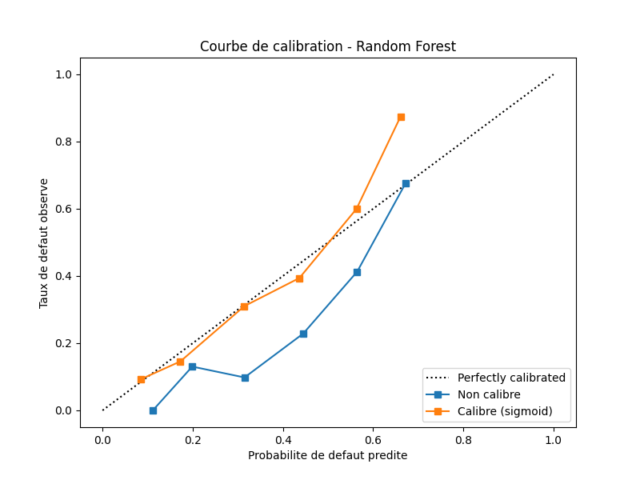

# Credit Scoring — Credit Risk Assessment

End-to-end data science project: predicting the probability of loan default, using the German Credit Data dataset.

## Objective

Build a complete pipeline — data cleaning, feature engineering, modeling, evaluation — to predict whether a client will repay their loan (good payer) or default (bad payer), following sound methodological practices for a real-world scoring project.

## Dataset

**Source**: [German Credit Data (with Credit Risk)](https://www.kaggle.com/datasets/kabure/german-credit-data-with-risk), an enriched version of the original UCI/Statlog dataset that includes the true target variable.

- 954 clients, 10 columns (9 features + 1 target)
- Target variable `Credit Risk`: `0` = good payer, `1` = default (remapped from 1/2)
- Realistic class imbalance: **~70% good payers / 30% defaults**

| Variable | Type | Description |
|---|---|---|
| Age | Numerical | Client's age |
| Sex | Categorical | Gender |
| Job | Categorical (encoded) | Skill level |
| Housing | Categorical | Housing type (own / rent / free) |
| Saving accounts | Categorical | Savings account level |
| Checking account | Categorical | Checking account level |
| Credit amount | Numerical | Requested loan amount |
| Duration | Numerical | Loan duration (months) |
| Purpose | Categorical | Purpose of the loan |

## Project pipeline

```
data/raw/               → Raw dataset
      │
      ▼ preprocess.py    (cleaning: dropping unused columns, handling missing values)
data/processed/clean.csv
      │
      ▼ features.py      (feature engineering: ratio, target remapping, encoding)
data/processed/features.csv
      │
      ▼ train_logistic.py / train_rf.py   (split, scaling, training, evaluation)
reports/                 (ROC curves, metrics)
```

## Key methodological point: detecting and fixing a data leakage issue

One of the core challenges of this project was identifying a **data leakage** problem:

1. The Kaggle dataset initially used contained **no real target column**. A target had been artificially fabricated from a threshold on `Credit amount` and `Duration` — two variables that were then reused as features. Result: a 0.998 ROC-AUC score, far beyond what the literature reports for this dataset (~0.75-0.80), a clear sign the model was "reading" a formula rather than an actual financial signal.
2. A second leak of the same kind was found in the training script itself (`Target_Class` derived from `Installment_Per_Month`).
3. The dataset was replaced with a version containing the real historical target (`Credit Risk`), and both faulty blocks were removed.
4. A more rigorous approach to missing values was also implemented: `Saving accounts` and `Checking account` had ~55% of their `NA`s dropped by an initial `dropna()`, causing a loss of 46% of the dataset's rows and distorting the class ratio (70/30 → 55/45). These `NA`s actually reflect the absence of that account type for the client, not missing data — they were therefore replaced with an explicit `"none"` category instead of being dropped.

After the fix, the headline metric is the average cost per client on the test set, using the German Credit Data cost matrix (lending to a future defaulter costs 5, rejecting a good payer costs 1):

| Policy | Average cost |
|---|---|
| Accept everyone | 1.518 |
| Reject everyone | 0.696 |
| **Model, threshold 0.1667** | **0.518** |

That is **26% lower cost** than the best trivial policy. Second, the ROC-AUC scores (0.756 for logistic regression, 0.770 for the Random Forest) are consistent with published benchmarks for this dataset.

## Exploratory analysis — key findings

- **`Checking account = none`** is the most discriminative signal in the dataset (correlation of -0.33 with risk). Counter-intuitively, having no checking account is associated with a lower default rate (~12% vs. ~30% on average) — likely a sign of a stable financial situation that doesn't require day-to-day cash management, rather than banking exclusion.
- **`Duration`** and **`Credit amount`** are positively correlated with risk: longer and larger loans are associated with more defaults.
- **`Housing = own`** is associated with lower risk than renting.
- **`Age`** and **`Sex`** show weak discriminative power on their own.

## Modeling

Two models were trained and compared on the same train/test split (80/20, stratified, `random_state=42`):

| Model | ROC-AUC | Notes |
|---|---|---|
| Logistic Regression | 0.756 | `StandardScaler` (fit on train only) + `class_weight='balanced'` |
| Random Forest (tuned) | **0.770** | `n_estimators=200`, `max_depth=6`, `min_samples_leaf=10`, `class_weight='balanced'` |

The unconstrained Random Forest (unlimited depth) achieved a lower AUC (0.74) than logistic regression — a classic case of overfitting on a small dataset (954 rows). Limiting tree depth and minimum leaf size allowed it to outperform logistic regression.

Both models converge on the same top features (`Checking account_none`, `Duration`, `Credit amount`), which reinforces confidence in these signals.

### Calibration and decision threshold

With `class_weight='balanced'`, the Random Forest overestimates risk: its mean predicted default probability is **44.6%** while the actual rate is **30.4%**. Sigmoid calibration (Platt scaling, `CalibratedClassifierCV`, cv=5) fixes this bias without changing how clients are ranked (AUC is unchanged). Sigmoid was chosen over isotonic, which tends to overfit on 954 rows.

Reliable probabilities make it possible to set the threshold from costs: under the German Credit Data cost matrix, lending to a future defaulter costs 5 times more than rejecting a good payer, giving an optimal threshold of 1/(1+5) ≈ **0.167**.

| | Mean p | Brier | AUC | Average cost / client |
|---|---|---|---|---|
| Uncalibrated, threshold 0.5 | 0.446 | 0.195 | 0.770 | 0.618 |
| Calibrated, threshold 0.167 | **0.302** | **0.170** | 0.769 | **0.518** (−16%) |



## Project structure

```
credit-scoring-project/
├── api/
│   └── main.py            # FastAPI scoring API
├── data/
│   ├── raw/               # Raw dataset
│   └── processed/         # Cleaned data and features
├── notebooks/
│   ├── 01_eda.ipynb       # Exploratory data analysis
│   └── 02_shap_explainability.ipynb  # SHAP interpretability
├── src/
│   ├── preprocess.py      # Cleaning (ETL)
│   ├── features.py        # Feature engineering
│   ├── train_logistic.py  # Logistic regression training
│   └── train_rf.py        # Random Forest training
├── models/                 # Trained model (generated by train_rf.py)
├── reports/                # Generated ROC curves
├── requirements.txt
└── README.md
```

## Setup and usage

```bash
pip install -r requirements.txt

python src/preprocess.py
python src/features.py
python src/train_logistic.py
python src/train_rf.py     # also saves models/rf_model.joblib
```

## Scoring API

The FastAPI app serves the trained Random Forest. It takes a client's raw data and applies the same feature engineering as `features.py`.

```bash
uvicorn api.main:app --reload
```

Interactive docs: http://127.0.0.1:8000/docs

| Method | Endpoint | Description |
|---|---|---|
| GET | `/health` | API and model status |
| POST | `/predict` | Score one client |
| POST | `/predict/batch` | Score a list of clients |

```bash
curl -X POST http://127.0.0.1:8000/predict   -H "Content-Type: application/json"   -d '{"age": 35, "sex": "male", "job": 2, "housing": "own", "saving_accounts": "little", "checking_account": "moderate", "credit_amount": 3000, "duration": 24, "purpose": "car"}'
```

```json
{"probability_of_default": 0.3622, "prediction": "default", "decision": "reject", "threshold": 0.1667}
```

## Next steps
- **Experiment tracking** (MLflow or a lightweight equivalent)
- **Amount-dependent threshold**: the cost matrix assumes a 5-to-1 ratio regardless of the loan amount, yet a default on 20,000 obviously does not cost the same as a default on 1,000. The complete version would be a threshold that depends on the amount, meaning one threshold per application rather than a single global threshold.

## Tech stack

Python · Pandas · Scikit-learn · Matplotlib · Git
